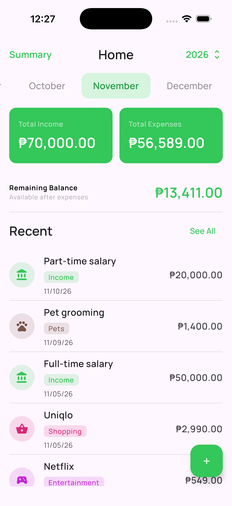
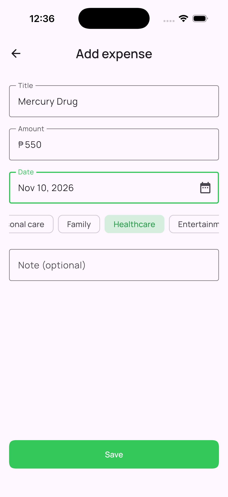
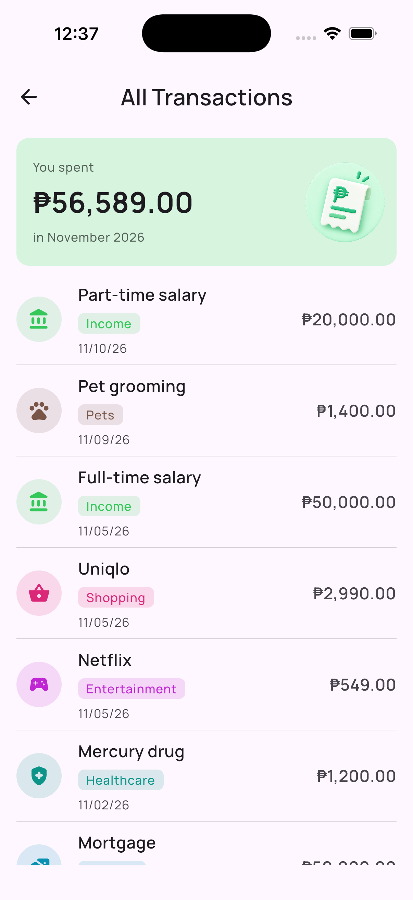
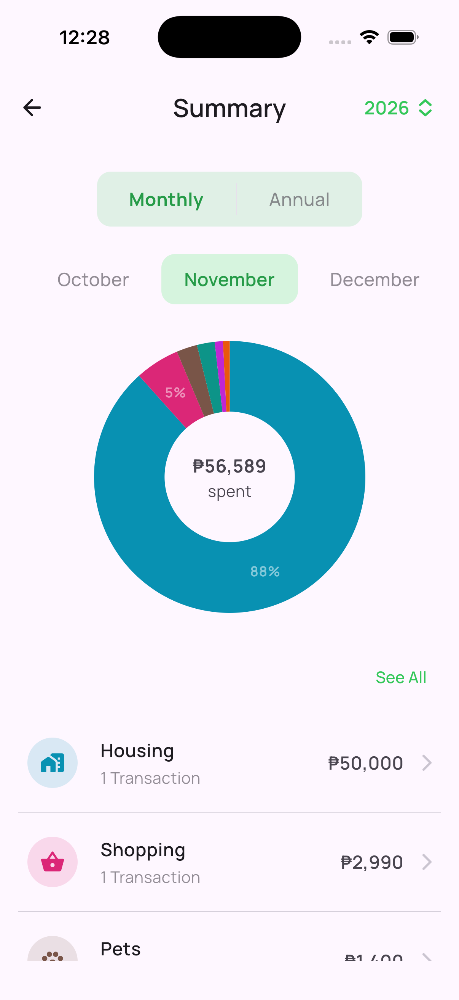
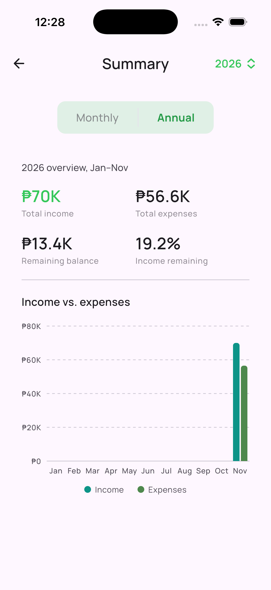

# Ledgr

Ledgr is a household spending tracker for Android and iOS, built with Kotlin Multiplatform and Compose Multiplatform. It started as a replacement for a budgeting spreadsheet that was tedious to update, so the focus is on logging spending quickly and seeing where the money went at a glance.

## Screenshots

<p align="center">
  
  
  
  
  
</p>

## Features

- **Expenses and income.** Add, edit and delete transactions with a title, amount, date, note and, for expenses, a category.
- **Categories.** 16 spending categories, each with its own icon and color, from Food and Groceries to Bills, Pets and Loans Given.
- **Transaction list.** Browse everything, or filter by type, category and month.
- **Monthly summary.** A donut chart of spending by category with percentages, plus a breakdown you can tap to see that category's transactions.
- **Annual report.** Total income, total expenses, remaining balance and the share of income left, with a month-by-month income vs. expenses chart. Tap a month to open its monthly summary.
- **Built for real use.** Works in portrait and landscape, supports light and dark themes, and has TalkBack descriptions for charts and totals.

## Tech stack

| Area | Library |
|---|---|
| UI | Compose Multiplatform, Material 3 |
| Persistence | Room (Kotlin Multiplatform) |
| Dependency injection | Koin |
| Navigation | Type-safe Navigation Compose with kotlinx.serialization |
| Dates | kotlinx-datetime |
| Async | Kotlin Coroutines and Flow |
| Architecture | MVVM with a repository layer, shared across Android and iOS |

Almost all of the app, including the UI, ViewModels and database, lives in shared Kotlin code. The iOS app is a thin Swift wrapper that hosts the shared Compose UI.

## Getting started

### Requirements

- Android Studio with the Kotlin Multiplatform plugin
- JDK 17 or newer
- Xcode (for the iOS app, macOS only)

You can check your setup with [kdoctor](https://github.com/Kotlin/kdoctor):

```bash
brew install kdoctor
kdoctor
```

### Run on Android

Open the project in Android Studio, pick the Android run configuration and run it on an emulator or a device.

### Run on iOS

Open `iosApp/iosApp.xcodeproj` in Xcode, choose a simulator and press Run. The Gradle build for the shared framework runs as part of the Xcode build.

## Development

Format the code and run the shared tests before committing:

```bash
./gradlew ktlintFormat
./gradlew :shared:allTests
```

CI runs the same checks on every push.

## Roadmap

- Sync with a backend API
- Add transactions by taking a photo of a receipt
- Import past data from the original spreadsheet (CSV)